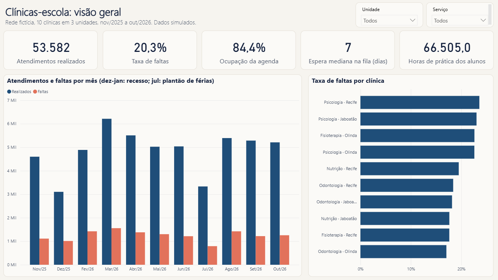

# Clínicas-escola em dados

Um ano de atendimentos de uma rede fictícia de clínicas-escola (Odontologia, Fisioterapia, Psicologia e Nutrição) em Recife, Olinda e Jaboatão: dados espalhados em planilhas e sistema, padronizados em Python e transformados em indicadores no Power BI, com a mesma base pronta para o Looker Studio.

## 🔗 Acessar o projeto

[](https://diegosantiago1.github.io/clinicas-escola-indicadores/)
[](https://diegosantiago1.github.io/Portifolio/#projetos)

**Painel animado:** https://diegosantiago1.github.io/clinicas-escola-indicadores/dashboard/ responde as perguntas da gestão em quatro telas (visão geral, agenda e fila, motivos, espera): faturamento, quem veio e quem faltou, professores, horários, motivos de falta e espera na recepção, com filtro por unidade, sons e um assistente de perguntas (sem IA: as respostas saem dos dados).

**Painel de trabalho:** https://diegosantiago1.github.io/clinicas-escola-indicadores/painel/ mostra a jornada de cada paciente em funil (na fila, chamado, em tratamento, sem retorno, encerrado), com o detalhe de cada um.

**Link direto:** https://diegosantiago1.github.io/clinicas-escola-indicadores/ abre a página de resultados, com a padronização ao vivo (digite como a recepção anotaria uma falta), as dez clínicas e os achados.



> **Dados 100% fictícios**, gerados por simulação. Não representam nenhuma instituição real.

## O problema

Odontologia e Fisioterapia registram os atendimentos no sistema; Psicologia e Nutrição, em planilhas preenchidas à mão, uma aba por mês. A mesma falta aparece como "Faltou", "falta", "F" e "Não compareceu". Sem juntar e padronizar tudo, ninguém sabe quantos pacientes faltam, quanto da agenda fica vazia nem se os alunos cumprem as horas de estágio.

## O que os dados mostram

| | |
|---|---|
| Atendimentos realizados | **53.582** de 70.679 agendamentos |
| Taxa de faltas | **20,3%** (faltas / (realizados + faltas)) |
| Horas de prática perdidas com faltas | **16.515 h** |
| Falta na segunda de manhã | **27,6%**, contra ~19% nos outros turnos |
| Falta na 1ª consulta de quem esperou mais de 60 dias | **41%**, contra 19% de quem esperou até 7 dias |
| Fisioterapia · Olinda | **41,5%** da agenda ocupada e **114 dias** de espera mediana: a primeira consulta só é marcada às segundas e quartas |
| Alunos na meta de horas (2026.1) | **121 de 183**; outros **43** teriam batido sem as faltas |
| Metade das faltas | vem de **19%** dos pacientes |
| Faturamento da taxa social | **R$ 962.535** no ano; as faltas de quem pagaria deixaram de trazer **R$ 240.320** |
| Faltas sem justificativa | **38%**; entre as justificadas, "esqueceu" e "trabalho" lideram, e a chuva sobe de 5% para 21% de abril a julho |
| Espera na recepção | **26 min** em média (33 min na Odontologia de Recife); na Odontologia o 2º horário do turno espera 7 min a mais que o 1º |

**O que fazer:** confirmar na véspera as primeiras consultas e a segunda de manhã; abrir primeira consulta todos os dias em Olinda e atualizar os telefones da fila; encaixe de reserva para quem falta muito; acompanhar as horas do aluno toda semana; validação de dados na planilha (lista suspensa e prontuário obrigatório).

## A padronização

O Python lê as 11 exportações do sistema, as 5 planilhas, a fila e as exportações do tablet da recepção (chegada, chamada e motivo de falta ou desmarcação), e aplica 20 regras. Cada regra é contada em `data/tratado/resumo_qualidade.csv`, e cada linha que precisa de conferência vai para `data/tratado/inconsistencias.csv` com arquivo, aba e linha.

| Regra | O que foi encontrado | O que foi feito |
|---|---|---|
| R01 | agendamento repetido entre exportações mensais (o filtro do sistema incluía o último dia do mês anterior) | removido |
| R02 | coluna nova (CANAL) a partir de maio | ignorada |
| R03 | situação escrita de 15 jeitos | padronizada em 4 |
| R04 / R05 | data e horário digitados como texto ("5/3/26", "8h") | convertidos |
| R07 | prontuário em branco | recuperado pelo nome, **só se o nome for único** (homônimos ficam sinalizados) |
| R08 / R09 / R10 | linha copiada, linha de total, linha em branco | removidas |
| R12 | ano digitado errado | corrigido pelo mês da aba |
| R13 | aluno com dois pacientes no mesmo horário | sinalizado |
| R15 | 1ª consulta antes da inscrição na fila | corrigida pelos atendimentos |
| R16 | motivo digitado em texto livre ("choveu muito", "sem passagem") | classificado em 8 motivos |
| R17 | chegada sem o horário de chamada | fora da média de espera |
| R18 | chegada registrada duas vezes (cartão passado de novo) | mantida a primeira |
| R19 | registro da recepção sem agendamento (o agendamento perdeu o prontuário) | sinalizado |

**Como sei que está certo:** a simulação guarda a verdade. Os testes comparam a base tratada com ela linha a linha: cada problema plantado é encontrado exatamente, a situação e o supervisor batem em 100% das linhas, e os 2.041 prontuários recuperados estão todos certos. O motivo, a espera e o valor cobrado também batem linha a linha.

## Arquitetura

```
simulacao.py ──► fontes.py ──► data/fontes/ (CSV do sistema, planilhas, fila, cadastros)
   (verdade)                         │
                                     ▼
                               padronizar.py ──► data/tratado/ (base tratada + inconsistências)
                                                     │
                     ┌───────────────────────────────┼──────────────────────────┐
                     ▼                               ▼                          ▼
            Power BI (PBIP)                indicadores.py              Looker Studio
   Power Query: tipos, chave,         painel.json + base do Looker    (via Google Sheets)
   mesclagem; 24 medidas DAX                        │
                     │                              ▼
                     └── conferir_powerbi.py ◄── página de resultados (site/)
                                                     │
                                  dashboard.py ──► painel animado (site/dashboard/)
```

## Tecnologias e por quê

- **Python (pandas, openpyxl):** simulação, padronização e indicadores. A limpeza fica num lugar só e serve às duas ferramentas de BI.
- **Power BI:** modelo estrela (atendimentos, oferta e fila ligados a calendário, clínicas, alunos e supervisores), Power Query e 24 medidas DAX, incluindo inteligência de tempo (mês anterior) e transição de contexto (alunos na meta). Cada medida conferida contra o Python no motor do Power BI.
- **Looker Studio:** a mesma base, já agregada (`data/looker/base_looker_studio.xlsx`), e os campos calculados prontos. Passo a passo em [docs/LOOKER_STUDIO.md](docs/LOOKER_STUDIO.md).
- **Excel:** as fontes são planilhas como as de uma recepção de verdade.
- **pytest + ruff + GitHub Actions:** 89 testes a cada push.
- **HTML, CSS e JavaScript + Chart.js:** as páginas, sem framework. O painel animado usa a Web Audio API para os sons (sintetizados, sem arquivos) e a View Transitions API para a troca de tema.

## Como rodar

```bash
python -m venv .venv && .venv\Scripts\activate
pip install -r requirements-dev.txt
set PYTHONPATH=src
python -m clinicas.fontes         # gera as fontes bagunçadas (e a verdade)
python -m clinicas.padronizar     # padroniza e gera data/tratado
python -m clinicas.indicadores    # indicadores, base do Looker e site/dados/painel.json
python -m clinicas.jornada        # a jornada de cada paciente para o painel de trabalho (site/painel)
python -m clinicas.dashboard      # números e respostas do painel animado (site/dashboard)
pytest                            # 89 testes
python powerbi/gerar_pbip.py      # gera o relatório Power BI
```

**Power BI:** abra `powerbi/clinicas_escola.pbip` no Power BI Desktop. Se a pasta do projeto for outra, ajuste o parâmetro `PastaDados` em Transformar dados → Editar parâmetros e clique em Atualizar. Ao fechar, **não salve** (o Power BI regravaria os arquivos gerados). Para conferir os números: `python scripts/conferir_powerbi.py` com o relatório aberto.

**Página:** `python -m http.server 8000 -d site` e abra http://localhost:8000 (dar duplo clique no `index.html` não carrega os dados).

## Documentos

- [docs/INDICADORES.md](docs/INDICADORES.md): dicionário de indicadores (nome, fórmula, fonte, frequência).
- [docs/DECISOES.md](docs/DECISOES.md): decisões técnicas e o que deu errado no caminho.
- [docs/LOOKER_STUDIO.md](docs/LOOKER_STUDIO.md): montar o painel no Looker Studio.

## Créditos

Fotos da página via Pexels (licença e links de cada foto em `site/img/creditos.json`).

---

Feito por **Diego Santiago**, analista de dados em Recife. [Portfólio](https://diegosantiago1.github.io/Portifolio/) · [LinkedIn](https://www.linkedin.com/in/diego-freitas-santiago)
